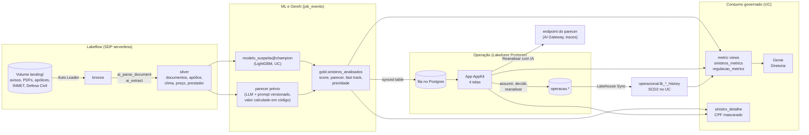

# Arquitetura

Uma plataforma só, do aviso que chega ao Volume até a decisão do regulador que volta ao lakehouse: **Lakeflow → Unity Catalog → ML e GenAI → gold → Lakebase → app e Genie**, com um lineage único no Unity Catalog. Tudo serverless, com nomes vindos da configuração (D-016).

## Fluxo de um evento

1. **Chegada.** Os lotes de avisos e PDFs caem no Volume (`scripts/simular_evento.py` simula o evento). A chegada do arquivo dispara o `job_evento` (`recursos/job_evento.yml`).
2. **Pipeline (bronze e silver).** O Auto Loader ingere tudo com metadados. Na silver:
   - `ai_parse_document` e `ai_extract` leem os PDFs (orçamento, laudo, nota);
   - o aviso é cruzado com a apólice (cobertura, vigência, LMI, franquia), com o clima real (estação INMET mais próxima e ocorrência da Defesa Civil), com a tabela de preços e com o histórico do prestador.
   - O resultado é `silver.sinistros_enriquecidos` e a entrada do parecer, `silver.entrada_parecer` (`src/pipeline/`).
3. **Análise (gold).** O notebook `processar_evento` pega só os avisos novos e os pareceres pendentes:
   - **score de suspeita:** modelo do UC com alias `champion` (D-021);
   - **parecer prévio:** o LLM decide e o código calcula o valor (D-022, D-023);
   - **regras de fast track e de prioridade** (`src/regras/fast_track.py`);
   - grava com `MERGE` em blocos, de forma idempotente, e pede a atualização da fila no Lakebase.
4. **Operação.** A synced table leva o gold ao Postgres. No app, o regulador:
   - assume o próximo caso, de forma atômica;
   - vê o parecer ao lado das evidências;
   - reanalisa com IA pelo endpoint;
   - registra a decisão, que é idempotente (D-024, D-026).
5. **Volta ao lakehouse.** O Lakehouse Sync leva `operacao.*` ao UC como histórico SCD2. A metric view `regulacao_metrics` mede a concordância IA × regulador, e as divergências viram rótulo para o retreino (próximo passo).
6. **Diretoria.** O Genie "Sinistros Clima — Diretoria" responde em português sobre as mesmas metric views do painel (D-025).

## Cada produto no seu papel

| Necessidade | Produto | Por quê |
|---|---|---|
| Ingestão contínua de arquivos e PDFs | Lakeflow (SDP) + Auto Loader | Incremental, com expectations, serverless e sem cluster para gerir |
| Ler PDFs e extrair campos | AI Functions (`ai_parse_document`, `ai_extract`) | SQL dentro do pipeline, sem serviço externo de OCR |
| Governança, lineage e catálogo de modelos | Unity Catalog | Uma fonte de verdade para tabelas, modelos, funções, metric views e permissões |
| Score de suspeita | MLflow + UC (alias `champion`, portão de promoção) | Versão, métrica e rollback rastreáveis |
| Parecer prévio | Foundation Model API + endpoint com AI Gateway | Avaliação com `mlflow.genai.evaluate`, traces, inference table e controle de uso |
| Fila e decisões (OLTP) | Lakebase Postgres | Transação, PK, lock e latência de milissegundos, que o warehouse não oferece |
| Painel e perguntas da diretoria | SQL Warehouse + metric views + Genie | Métrica definida uma vez e usada em todo lugar |
| Interface do regulador | Databricks Apps (AppKit) | Identidade do usuário, recursos declarados e deploy pelo bundle |

## Implantação

- **Bundle principal** (`databricks.yml`, `recursos/`): pipeline, jobs (evento, treino e avaliação do parecer) e experimentos. O pacote Python do projeto vai como wheel (D-019).
- **Bundle do app** (`app/databricks.yml`): app, warehouse, Lakebase e endpoint como recursos do app.
- **Scripts idempotentes** para o que o bundle ainda não cobre:
  - `provisionar_lakebase.py`: projeto, synced table e Lakehouse Sync;
  - `genie_diretoria.py`;
  - `permissoes_app.py`;
  - SQL da governança e das metric views (`src/governanca/9x_*.sql`, rodados por `scripts/executar_sql.py`).
- **O que o lineage do UC mostra:** pipeline → silver → gold (job) → synced table (pipeline), e o histórico das decisões no schema `operacional`. Os detalhes estão em `evidencias/02-governanca.md` e `evidencias/08-rastreio-ponta-a-ponta.md`.

## Escala e limites conhecidos

- O pipeline processou os 8 mil avisos e os 9.705 PDFs do evento em cerca de 26 minutos na execução do `job_evento` (D-023); o lote 1 está detalhado em `evidencias/01-ingestao.md`.
- **Gargalo medido: a vazão do LLM no parecer em lote.** O FMAPI pay-per-token ficou em ~21 pareceres por minuto. Em produção, isso pede throughput provisionado; o dimensionamento é uma referência, a calibrar na PoC (D-023).
- O app e o Lakebase escalam a zero fora do evento; o custo fixo fora do pico é baixo (`evidencias/09-custo-real.md`).
